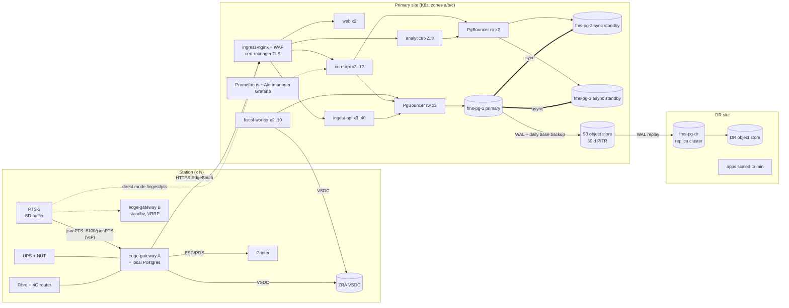

# FMS deployment and operations runbook

This runbook covers how the National Fuel Monitoring System is packaged, run, scaled, failed over, backed up and secured. Architecture is described in `docs/DESIGN.md` §3, §6, §10 and §11, and ports and environment variables in `docs/api/CONTRACTS.md`.

| Path | What |
|---|---|
| `docker-compose.yml`, `.env.example` | Local full stack and HA demo. Profiles: core (default), `edge`, `observability` |
| `postgres/` | Streaming-replication bootstrap for compose (primary init, replica entrypoint) |
| `nginx/nginx.conf` | Local reverse proxy and load balancer |
| `monitoring/`, `grafana/` | Prometheus config and rules, postgres-exporter business queries, Grafana datasource and "FMS overview" dashboard |
| `migrate/Dockerfile` | Migration runner image (`db/migrate.mjs`) |
| `pts-simulator/Dockerfile` | PTS-2 simulator image |
| `k8s/base`, `k8s/overlays/{staging,production}`, `k8s/components/custom-metrics-hpa`, `k8s/dr` | Production Kubernetes (Kustomize, CloudNativePG) |
| `edge/` | Station installation kit: compose, systemd, keepalived, update, commissioning |
| `../.github/workflows/ci.yml` | CI: tests, image build, Trivy, GHCR push, cosign |
| `../Makefile` | `make up / down / logs / migrate / seed / test / build-images / sim / sim-fleet` |

## 1. Topology



**Local compose** runs the following:

| Group | Services |
|---|---|
| Database | `pg-primary` → `pg-replica` (async streaming, slot `replica1`) |
| One-shot | `migrate` |
| Cloud services | `core-api` ×2, `ingest-api` ×2, `fiscal-worker` ×2, `analytics`, `web`, `mock-vsdc` |
| Proxy | `proxy` (nginx: `/api` `/ingest` `/analytics` `/`) |
| `edge` profile | `edge-db`, `edge-gateway` (LUS-0001), `pts-simulator` |
| `fleet` profile | `pts-fleet`: 200 simulated direct-mode controllers posting to `ingest-api` |
| `observability` profile | `postgres-exporter`, `prometheus`, `grafana` |

## 2. Running locally

Prerequisites: Docker with Compose v2.20 or later, and GNU make (use Git Bash or WSL on Windows).

```bash
cp deploy/.env.example deploy/.env      # optional; defaults are built in
make up                                 # core stack -> http://localhost:8000
make up-all                             # + edge station + Prometheus/Grafana
make sim                                # edge gateway + PTS-2 simulator, follow logs
make sim-fleet                          # + 200 simulated stations (dev only), see tools/pts-simulator/README.md
make sim-fleet-stop                     # stop them (the stations stay in the database)
make logs SERVICE=ingest-api
make migrate | make seed                # schema only | schema + demo seed
make down | make clean                  # stop | stop and wipe volumes
```

core-api, ingest-api and fiscal-worker all run from the Django image built from `services/cloud`;
`FMS_SERVICE=core|ingest|worker` picks the role (see `services/cloud/README.md`).

| URL | What |
|---|---|
| http://localhost:8000 | Web portal through the proxy (`/api/v1`, `/ingest`, `/analytics/v1`) |
| http://localhost:8101 | Edge gateway local UI (station LUS-0001) |
| http://localhost:8100/jsonPTS | Edge PTS-2 listener |
| http://localhost:3000 | Grafana (admin/admin), dashboard "FMS overview" |
| http://localhost:9090 | Prometheus |
| localhost:5432 / 5433 | Postgres primary / replica (`fms` / `fms-dev-password`) |

**Demo credentials** (from `db/seed/001_demo.sql`, dev only):
- All demo users have the password `ChangeMe123!`.
- Gateway: `GW-LUS-0001` / `gwLUS001.dev-gateway-key-lus-0001`.
- PTS-2: `003B00265030500420303531` / `devsecret-lus-0001`.

### HA exercises with compose

| Exercise | Command | Expected |
|---|---|---|
| Lose an API replica | `docker kill fms-core-api-1` | nginx marks it failed (`max_fails`) and retries on the other. The UI keeps working. |
| Scale out | `docker compose -f deploy/docker-compose.yml up -d --scale ingest-api=4 --no-recreate` | nginx re-resolves within 10 s and Prometheus discovers the new targets. |
| Cloud outage at a station | `docker compose ... stop proxy` while `make sim` runs | The edge keeps accepting and fiscalising, and its outbox backlog rises (Grafana "Gateway backlog"). After `start proxy` it drains. |
| VSDC outage | `docker compose ... stop mock-vsdc` | Sales stay `fiscal_status=pending` and the "Fiscal backlog" panel rises. They are signed after a restart. |
| Primary DB loss (manual promotion) | `docker compose ... stop pg-primary`, then `docker compose ... exec pg-replica psql -U fms -c "select pg_promote()"`, then point `DATABASE_URL` at `pg-replica` and `up -d` | Shows what CNPG automates in production. Rebuild the old primary afterwards: `docker volume rm fms_pg-primary-data`, then swap the roles. |

Compose replication is **asynchronous** so the demo keeps running when the replica stops. Production uses a synchronous standby.

### Assumptions about other components (integrator: verify)

| Assumption | Where |
|---|---|
| The Node images (edge-gateway, migrate, pts-simulator) have `node` on PATH (healthchecks use `node -e fetch(...)`). The cloud and analytics images have `python`. The web image is nginx on :80 with busybox `wget` (alpine). | `docker-compose.yml` |
| `fiscal-worker` (`FMS_SERVICE=worker`) serves `/healthz`, `/readyz` and `/metrics` on 9464 (`METRICS_PORT`). | compose, k8s |
| The mock VSDC runs from the edge-gateway image as `node /repo/packages/zra-client/bin/mock-vsdc.js` (`PORT=8200`); that image contains `packages/zra-client`. | compose `mock-vsdc` |
| Edge gateway environment variables: `DATABASE_URL`, `PORT`=8100, `UI_PORT`=8101, `STATION_CODE`, `GATEWAY_CODE`, `GATEWAY_KEY` (also set as `GATEWAY_API_KEY`), `PTS_ID`, `PTS_SECRET`, `CLOUD_INGEST_URL`=`http://proxy/ingest` (the gateway appends `/v1/edge/batches`), `ZRA_*`, `PRINTER_MODE`. Metrics on 8101. The native entry point is `services/edge-gateway/dist/index.js`. | compose, `edge/` |
| The simulator accepts `--url --pts-id --secret` (extra flags go in `SIM_EXTRA_ARGS`). Its build is `tools/pts-simulator` → `dist/cli.js`, depending on `@fms/shared` via `file:`. | `pts-simulator/Dockerfile` |
| HTTP metrics come from a Fastify-style histogram `http_request_duration_seconds{route,status_code}`. The dashboards and alerts use it. | Grafana, PrometheusRule |
| The edge gateway applies its own local schema on start. | edge |

## 3. Production deployment (Kubernetes)

Cluster prerequisites:
- CloudNativePG ≥ 1.26 and `plugin-barman-cloud` (namespace `cnpg-system`)
- cert-manager with `ClusterIssuer`s `letsencrypt-prod` and `letsencrypt-staging` (or the government CA)
- ingress-nginx (namespace `ingress-nginx`) with ModSecurity enabled
- External Secrets Operator
- kube-prometheus-stack (namespace `monitoring`)
- optionally prometheus-adapter, for `components/custom-metrics-hpa` with the rules in `adapter-rules.example.yaml`
- a CSI StorageClass `fast-ssd` with volume expansion
- a network plugin that enforces NetworkPolicy (Calico or Cilium)
- nodes labelled `topology.kubernetes.io/zone`

> The upstream **ingress-nginx** project was retired in March 2026 and now gets no further security fixes. The annotations in `k8s/base/ingress.yaml` target it as requested. Plan a migration to a maintained controller: either the Gateway API (Envoy Gateway, Cilium, or NGINX Gateway Fabric) or F5 NGINX Ingress, whose annotations differ.

Deploy order:

```bash
kubectl apply -k deploy/k8s/overlays/production      # namespace, secrets, DB, apps
kubectl -n fms wait --for=condition=Ready cluster/fms-pg --timeout=20m
kubectl -n fms wait --for=condition=complete job/fms-migrate --timeout=15m
kubectl -n fms rollout status deploy/core-api deploy/ingest-api deploy/fiscal-worker deploy/analytics deploy/web
```

On each release:
1. CI sets the image tags or digests in the overlay (`kustomize edit set image`).
2. Delete the previous `fms-migrate` Job (Jobs are immutable).
3. Apply. The migration must be **expand/contract compatible** with the previous release.

Argo CD runs the Job as a PreSync hook automatically.

## 4. Scaling guidance

These figures assume edge batches every 5 s per station, PTS-2 status every 1–5 s (aggregated by the gateway), and about 600 sales per station per day.

| Stations | Ingest req/s (peak) | ingest-api pods | core-api | fiscal-worker | analytics | Postgres (per instance) | Data growth |
|---|---|---|---|---|---|---|---|
| ≤ 500 | ~100–200 | 3 | 3 | 2 | 2 | 4 vCPU / 16 GB, 500 GB | ~5 GB/month |
| 500–1,500 | ~300–600 | 4–8 | 3–6 | 2–4 | 2–4 | 8 vCPU / 32 GB, 1–2 TB | ~15 GB/month |
| 1,500–5,000 | ~600–2,000 | 8–20 | 6–10 | 4–8 | 4–8 | 16–32 vCPU / 64–128 GB, 4 TB+ | ~50 GB/month |
| > 5,000 | — | 20–40 | 10+ | 8+ | 8+ | Move telemetry to TimescaleDB or Citus, sharded by `station_id` (DESIGN §5) | — |

- **ingest-api.** It is stateless and CPU-bound on JSON and HMAC. Scale on CPU at 65% and on `http_requests_per_second` (150 per pod). Keep the PgBouncer rw `default_pool_size` × number of poolers below the Postgres `max_connections` minus 50.
- **fiscal-worker.** Scale on the queue backlog: the external metric `fms_jobs_ready{kind="fiscalise"}`, at 200 per pod. `SKIP LOCKED` makes extra workers safe.
- **Partitions.** `ensure_partitions()` creates monthly partitions 3 months ahead. Run `SELECT fms.ensure_partitions(1,3);` monthly; schedule it as a job or rely on the migration. At 1,000 stations, `pump_transactions` is about 18 M rows a month (~10 GB with indexes) and `tank_measurements` 60–150 M rows a month. Above about 3,000 stations, switch `tank_measurements` to weekly partitions, or to a hypertable.
- **Read path.** Dashboards and analytics use `DATABASE_URL_RO` (the ro pooler, which serves the standbys). Add CNPG instances to add read capacity. Only one is synchronous (`maxSyncReplicas: 1`).
- **Storage.** Keep 30% free (alert `FmsPgStorageFilling`). Expand PVCs online by editing `spec.storage.size`.

## 5. Failover procedures

### 5.1 Database failover (automatic, CNPG)

1. The primary pod or its node fails. CNPG promotes the **synchronous standby**, which is in another zone by `syncReplicaElectionConstraint`. This typically takes under 60 s, and RPO is 0 for acknowledged commits.
2. The services `fms-pg-rw` and the PgBouncer pool follow the new primary. Apps see brief connection errors and retry. Edges and the PTS-2 re-send anything that was not acknowledged.
3. Verify:
   ```bash
   kubectl cnpg status fms-pg -n fms
   kubectl -n fms get pods -l cnpg.io/cluster=fms-pg -L role
   ```
   Confirm that `FmsPgNoSyncStandby` clears once the old primary rejoins (via pg_rewind) as a standby.
4. **Planned switchover** (maintenance): `kubectl cnpg promote fms-pg fms-pg-2 -n fms`.
5. **If writes block**: with one sync standby required and no standby left, commits wait. If both standbys are gone for an extended time and availability matters more than RPO, temporarily set `minSyncReplicas: 0`. This is a documented risk acceptance, so revert it afterwards.

### 5.2 DR switchover (loss of the primary site)

Decide with the incident commander. The DR replica is behind by up to `archive_timeout` (5 min) plus WAL shipping. Edges and the PTS-2 will re-send unconfirmed data.

1. Fence the primary site if it is reachable: `kubectl cnpg fencing on fms-pg "*" -n fms`, and scale its ingress to 0.
2. Promote DR: in `deploy/k8s/dr/replica-cluster.yaml` set `spec.replica.enabled: false`. With the CNPG ≥ 1.25 distributed topology, use `replica.primary: fms-pg-dr` instead. Apply, then wait until the cluster is Ready and the primary is writable.
3. Create the poolers for `fms-pg-dr`, or patch `DB_HOST_RW`/`DB_HOST_RO` in `fms-config`. Then scale the DR app deployments up.
4. Switch DNS for `fms.example.zm` to the DR ingress (use a TTL of 60 s or less). cert-manager issues the certificate at DR, or use pre-staged certificates.
5. Watch the gateway backlogs drain (`FmsGatewayBacklogGrowing` clears) and check the fiscal backlog.
6. **Failback**: rebuild the original site as a replica cluster of `fms-pg-dr` (same manifest, reversed). Then repeat steps 1–5 in the other direction in a maintenance window.

### 5.3 Edge gateway swap (failed mini-PC)

1. **Dual-unit station**: the standby already holds the VIP. Nothing is lost. Replace the failed unit at leisure.
2. **Single-unit station**: the PTS-2 buffers on SD (and uploads directly if a backup remote server is configured).
3. Image the replacement, either with the same `.env` (same `GATEWAY_CODE`) or with a new gateway registered in the admin console and the old one disabled. Rotate the gateway key if the old disk is not recovered.
4. `docker compose up -d` (or `install-systemd.sh`). The PTS-2 re-sends everything not confirmed.
5. **If the old disk is readable**: start its Postgres and let that gateway drain its outbox once. Idempotent ingest removes the duplicates. Unsynced records on the old disk can include sales that were fiscalised but not yet synced.
6. Re-run sections C, D and F of `edge/COMMISSIONING.md`.

### 5.4 Restore from PITR (corruption or operator error)

Never restore over the live cluster. Restore to a **new** cluster, verify, then cut over.

```yaml
apiVersion: postgresql.cnpg.io/v1
kind: Cluster
metadata: { name: fms-pg-restore, namespace: fms }
spec:
  instances: 3
  imageName: ghcr.io/cloudnative-pg/postgresql:16
  storage: { size: 1Ti, storageClass: fast-ssd }
  walStorage: { size: 200Gi, storageClass: fast-ssd }
  bootstrap:
    recovery:
      source: origin
      recoveryTarget:
        targetTime: "2026-11-27 08:15:00+00"   # just before the bad change
  externalClusters:
    - name: origin
      plugin:
        name: barman-cloud.cloudnative-pg.io
        parameters: { barmanObjectName: fms-pg-backup, serverName: fms-pg }
  plugins:   # archive to a NEW path; never share the origin's serverName
    - name: barman-cloud.cloudnative-pg.io
      isWALArchiver: true
      parameters: { barmanObjectName: fms-pg-backup, serverName: fms-pg-restore }
```

1. Apply this, then verify the data (row counts, last `pump_transactions.ended_at`, application smoke tests against the new rw service).
2. **Choose a cutover**:
   - (a) Point `DB_HOST_RW`/`RO` at poolers for `fms-pg-restore`.
   - (b) Copy only the damaged rows back into `fms-pg` with `pg_dump -t ...`. This is preferred when the damage is narrow, because it keeps the edge data that arrived after the target time.
3. Telemetry received after the recovery target can be **replayed**. Edges re-send unconfirmed records, and `fms.ingest_raw` keeps raw packets that can be re-processed.

## 6. Backup and restore drill (monthly)

| Step | Check |
|---|---|
| 1 | The `ScheduledBackup fms-pg-daily` succeeded in the last 26 h: `kubectl -n fms get backups --sort-by=.metadata.creationTimestamp` |
| 2 | WAL archiving is healthy: `kubectl cnpg status fms-pg` shows "Working WAL archiving: OK" and `cnpg_pg_stat_archiver_seconds_since_last_archival` is under 300 |
| 3 | Restore to a scratch namespace using §5.4 with `targetTime` = now − 1 h. Record the **RTO** (time to Ready) |
| 4 | Verify: `SELECT count(*), max(ended_at) FROM fms.pump_transactions;` is within the expected range. Run the core-api smoke test against the restored DB. Record the **RPO** |
| 5 | Confirm a copy exists in the **second region or DC** (bucket replication or `rclone sync`). Restore from that copy every quarter |
| 6 | Delete the scratch cluster. Log the results (date, backup ID, RTO, RPO, operator) in the ops register |

Targets: RPO 0 for a single-zone failure, at most 5 min for site loss. RTO under 60 s for a zone, under 2 h for a site, under 4 h for PITR.

## 7. Monitoring and alerts

Grafana dashboard: **FMS overview** (`grafana/dashboards/fms-overview.json`, provisioned automatically in compose; import it into the production Grafana). It shows stations online/offline, ingest rate, batch latency, fiscal backlog, gateway backlog, job queue depth and replication lag.

| Alert | Meaning | Response |
|---|---|---|
| `FmsStationsOfflineSpike` / `FmsStationsOfflineRatioHigh` | Many stations went offline in 15 min | If one province: check the ISP or power outage there, and notify ERB provincial. If national: check ingress, ingest-api 5xx, DNS and certificates. Edges buffer, so there is no data loss, but compliance reports will show gaps |
| `FmsGatewayBacklogGrowing` | A gateway's outbox is not draining | Check the station's WAN (4G failover), gateway logs (`journalctl -u fms-edge-gateway` or `docker logs`), its clock, and key validity (401s in the ingest logs) |
| `FmsGatewaySilent` | No heartbeat for 24 h | Call the station. This is an ERB compliance case after 24 h. Dispatch a technician |
| `FmsFiscalBacklog` / `FmsFiscalFailures` | Sales unsigned for more than 1 h | Check ZRA VSDC reachability and status, fiscal-worker logs, and edge VSDC errors. Escalate to the ZRA liaison. Never manually mark sales as signed |
| `FmsJobsDeadLetter` | Jobs exceeded `max_attempts` | Inspect with `SELECT kind,last_error,count(*) FROM fms.jobs WHERE status='dead' GROUP BY 1,2;`. Fix the cause, then requeue with `UPDATE fms.jobs SET status='queued',attempts=0,run_at=now() WHERE status='dead' AND kind=...` |
| `FmsJobQueueStalled` | Due jobs waiting more than 15 min | Check fiscal-worker pods, HPA and DB locks (`pg_stat_activity`). Scale up |
| `FmsIngest5xxRate` | ingest-api errors above 2% | Check the pod logs, the DB (pooler saturation `cnpg_pgbouncer_pools_cl_waiting`) and recent deploys. Roll back if a release is the cause |
| `FmsApiLatencyHigh` | p95 above 1.5 s | Check slow queries (`pg_stat_statements`), HPA limits and node pressure |
| `FmsPgReplicationLag` | A standby is more than 30 s behind | Check the standby's I/O and network, and long queries on the standby (`hot_standby_feedback`). If it is the sync standby, commits are slowed |
| `FmsPgNoSyncStandby` | RPO is no longer 0; writes may block | Check the standby pods, PVCs and zone health. See §5.1 step 5 |
| `FmsPgWalArchivingFailing` | The PITR window is at risk, and WAL is piling up on the primary | Check S3 credentials (ExternalSecret `fms-backup-s3`), the endpoint, the bucket quota and NetworkPolicy egress. Watch WAL PVC usage |
| `FmsPgBackupFailed` | The daily base backup failed or is stale | Run `kubectl -n fms describe backup <latest>` and check the plugin logs in `cnpg-system`. Trigger a manual backup with `kubectl cnpg backup fms-pg --method plugin --plugin-name barman-cloud.cloudnative-pg.io` |
| `FmsPgStorageFilling` | A PVC has less than 15% free | Expand the PVC, check for bloat and retention jobs, and detach old raw partitions |
| `FmsCertificateExpiringSoon` / `NotReady` | TLS renewal is failing | `kubectl describe certificate,certificaterequest,order -n fms`. Check DNS and HTTP-01 reachability and the issuer |

## 8. Security hardening checklist

- [ ] **Secrets.** Secrets live only in the vault and reach the cluster through External Secrets (`k8s/base/security/external-secrets.yaml`). Nothing secret is committed; `.env.example` holds dev values only. Rotate JWT, webhook and S3 keys every 90 days, and gateway keys on swap or compromise.
- [ ] **Controller secrets** (`controllers.hmac_secret`) are encrypted at rest in production (pgcrypto with `FIELD_ENCRYPTION_KEY` from KMS/vault, DESIGN §10). Keys never appear in logs.
- [ ] **Kubernetes Secret encryption at rest.** Enable the API server `EncryptionConfiguration` with a KMS v2 provider, so etcd never holds plaintext. Restrict `get secrets` RBAC in `fms*` namespaces to the operators group.
- [ ] **TLS everywhere.**
  - cert-manager certificates on the ingress, with HSTS set in the controller ConfigMap.
  - Postgres uses `sslmode=require` (CNPG certificates). Pin `verify-full` with the CNPG CA in production.
  - PTS-2 → gateway runs on the station LAN, HMAC-signed. Enable PTS-2 TLS if the firmware supports it.
  - Gateway → cloud is HTTPS only.
- [ ] **NetworkPolicies.** Default-deny is applied, and only the documented paths are allowed (`k8s/base/security/networkpolicies.yaml`). Tighten the S3 egress to the object-store CIDR.
- [ ] **WAF.** ModSecurity with OWASP CRS is on the interactive ingress. Per-IP rate limits are on the API and ingest. The partner API also has per-client limits in core-api.
- [ ] **Pod security.**
  - Non-root, read-only root filesystem, all capabilities dropped and seccomp `RuntimeDefault` for every workload. The exception is web on nginx:80; switch it to `nginx-unprivileged`.
  - The namespace enforces PSA `baseline` and warns on `restricted`.
  - ServiceAccount tokens are not mounted.
- [ ] **Supply chain.**
  - Images are pinned by digest in production.
  - Trivy runs in CI; a fixable CRITICAL fails the build.
  - SBOM and provenance are attached, and images are signed with cosign.
  - Enforce signatures at admission (Kyverno or the sigstore policy-controller). Stations verify signatures themselves (`edge/update.sh`).
  - Pin GitHub Actions to commit SHAs.
- [ ] **Database.**
  - The superuser is disabled (`enableSuperuserAccess: false`) and apps use the `fms` owner role. Consider separate least-privilege roles per service, with a read-only role for analytics.
  - Data checksums are on, and backups are encrypted (SSE AES256), with bucket versioning and object lock.
- [ ] **Audit log retention.**
  - `fms.audit_log` is kept for at least **7 years** (to confirm with ERB and ZRA) and is append-only for the app role (REVOKE UPDATE/DELETE).
  - Kubernetes API audit logs and ingress access logs are shipped to central log storage and kept for at least 1 year.
  - CNPG and pgaudit logs are shipped too.
- [ ] **Access.**
  - MFA for `platform_admin` and the regulator roles.
  - The cluster API is reachable only over VPN or bastion.
  - Break-glass accounts are audited.
- [ ] **Edge.**
  - Full-disk encryption (LUKS with TPM unlock) on the mini-PCs.
  - No inbound WAN ports; the UI is on the LAN only; the BIOS is password protected.
  - `.env` is mode 600, and keys are unique per gateway.
- [ ] **Data residency.** Hosting must be in a Zambian DC or government cloud (DESIGN §12). This includes the object storage and the DR site.

## 9. Data retention policy (draft, to confirm with ERB, ZRA and legal)

| Data | Store | Retention | Mechanism |
|---|---|---|---|
| Raw jsonPTS packets (`fms.ingest_raw`) | Postgres monthly partitions | **90 days** online | Detach partitions older than 90 days, export them to the object store (Parquet or `pg_dump`) for re-processing for 1 year, then drop |
| Telemetry (`pump_transactions`, `tank_measurements`, `tank_deliveries`, `alerts`) | Postgres partitions | **7+ years (per tax law, to confirm with ZRA)** | Keep 24 months hot. Older partitions go to cheaper tablespace, or are exported to object store with object lock |
| Fiscal receipts (`fiscal_receipts`) | Postgres | **7+ years (to confirm with ZRA)** | Never deleted while within the legal period |
| Daily roll-ups (`daily_station_product`), ERB exports | Postgres + object store | 10 years (to confirm with ERB) | Small, kept online |
| `audit_log` | Postgres + log archive | 7+ years (to confirm) | Append-only, exported yearly |
| `jobs` (done) | Postgres | 30 days | Periodic `DELETE ... WHERE status='done' AND created_at < now()-'30 days'` |
| Backups (base + WAL) | Object store | 30 days PITR (`retentionPolicy`) plus monthly copies kept 12 months | Barman retention and bucket lifecycle |
| Edge outbox | Station Postgres | Until synced, then 30 days | Gateway housekeeping |
| Metrics and logs | Prometheus / logging | 15–30 days metrics, 1 year logs | Stack configuration |

The `7+ years` figures are an assumption based on the Zambian Income Tax and VAT record-keeping requirements. They **must be confirmed** by ZRA and ERB legal before go-live.

## 10. CI/CD (`.github/workflows/ci.yml`)

- `shared` runs first. Then a `node` matrix covers every package and service: install, typecheck, lint, test and build against a `postgres:16` service with migrations and seed applied. All steps are `--if-present`, and components that don't exist yet are skipped.
- `analytics` runs pytest; `web` builds; `mobile` typechecks.
- `deploy-config` YAML-parses the deploy files, runs `docker compose config` and builds every kustomize overlay.
- `images` is a matrix over every Dockerfile. Each image is built and scanned by Trivy (SARIF goes to code scanning, and a fixable CRITICAL fails the job). On `main` and `v*` tags it is pushed to `ghcr.io/<owner>/fms/<name>` with SBOM and provenance, and signed with cosign (key from the `COSIGN_PRIVATE_KEY` secret, otherwise keyless).
