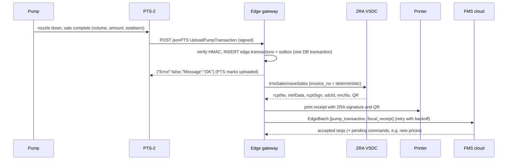

# National Fuel Monitoring System (FMS): Design Document

| | |
|---|---|
| Status | v0.1, implementation in progress |
| Date | 27 November 2026 |
| Scope | Every licensed filling station in Zambia, across all 10 provinces |
| Primary database | PostgreSQL 16 |

## 1. Goals

1. **Monitor every station in real time.** That covers dispenser sales per pump and nozzle, and tank levels from the ATG (automatic tank gauge) at every station, including water, temperature, deliveries and leak alarms.
2. **Fiscalise every sale.** Each sale goes to the Zambia Revenue Authority (ZRA) Smart Invoice system (VSDC), which returns an electronically signed receipt. That receipt is printed on a fiscal or receipt printer with its ZRA QR code.
3. **Owner and manager visibility.** The FMS server shows owners and managers their sales, stock position, deliveries, reconciliation and alerts, on the web and in a mobile app.
4. **Regulator visibility.** The Energy Regulation Board (ERB) sees the stock and sales of every station in the country by province, has compliance tools, and gets analytics and predictions: demand forecasts, stock-outs, national reserve days-of-cover and price simulation. Custom AI models can be plugged in.
5. **Open APIs.** Other authorities and partners get partner REST APIs and signed webhooks.
6. **Scalable, robust and redundant.** No single point of failure should lose data or stop a station from selling and fiscalising.

## 2. Input analysis: the documents in this folder

| Document | Key facts used in the design |
|---|---|
| `PTS-2-forecourt-controller-leaflet.pdf` | Each PTS-2 controller handles up to 50 dispensers, 50 tanks, 50 RFID readers and 5 price boards. It supports more than 145 dispenser brands and more than 50 ATG and probe brands. It has RS-232, RS-485 and Ethernet, and SSL/TLS. It keeps an internal database of sales, tank measurements, deliveries and alerts, and can upload automatically to a remote cloud server. |
| `PTS-2-forecourt-controller-technical-guide.pdf` (R12, April 2026) | **Communication to remote server** (pp. 110–117): the PTS-2 is an HTTP client. It pushes pump transactions, tank measurements, in-tank deliveries, alert records, GPS records, real-time status (every second or faster) and configuration, using the **jsonPTS** protocol. Requests are signed with a configurable **secret key**. It also supports a WebSocket channel (RFC 6455) for full remote control, such as price updates. Records are saved to an SD card, and the controller keeps an *uploaded* counter, so unconfirmed records are re-sent. **Automatic operation** (pp. 107–109): pumps can be set to authorise on nozzle-up, close the transaction automatically and read the totalisers automatically, so the PTS-2 can run a station with no POS. Pump **totalisers** cannot be reset, which is what lets the server detect manual-mode theft. |

**Design consequence:** the PTS-2 controller is the source of truth on the forecourt. It already abstracts every dispenser and ATG brand into a single protocol and gives the first layer of store-and-forward on its SD card. So the FMS does not talk to pumps or probes directly. It integrates with jsonPTS.

The field-level jsonPTS specification is a separate Technotrade document and is **not in the folder**. The adapter in `packages/shared/src/jsonpts.ts` follows the published jsonPTS conventions and is deliberately tolerant. Every raw packet is archived (`fms.ingest_raw`) so it can be re-processed. Section 12 lists what must be verified.

## 3. Architecture overview

```mermaid
flowchart LR
  subgraph Station["Filling station (x N, every province)"]
    D[Dispensers<br/>145+ brands] -- RS-485 --> PTS[PTS-2 forecourt<br/>controller<br/>SD-card buffer]
    ATG[ATG probes<br/>50+ brands] -- RS-485 --> PTS
    PTS -- jsonPTS/HTTPS<br/>primary --> EG[Edge gateway<br/>(local Postgres outbox)]
    EG -- ZRA VSDC API --> VSDC[(ZRA Smart Invoice<br/>VSDC)]
    EG -- ESC/POS --> PR[Fiscal / receipt<br/>printer]
    EG2[Standby edge gateway] -. hot standby .- EG
  end

  EG -- "EdgeBatch over HTTPS<br/>(at-least-once, idempotent)" --> LB
  PTS -. "jsonPTS direct<br/>(fallback / no-gateway sites)" .-> LB

  subgraph Cloud["FMS cloud (2 availability zones / 2 data centres)"]
    LB[Load balancer / WAF<br/>TLS termination] --> ING[ingest-api x N]
    LB --> CORE[core-api x N]
    LB --> AN[analytics x N]
    LB --> WEB[web app<br/>static/CDN]
    ING --> PGP[(PostgreSQL primary)]
    CORE --> PGP
    CORE --> PGR[(read replicas)]
    AN --> PGR
    PGP == sync streaming ==> PGS[(sync standby<br/>other zone)]
    PGP == async ==> PGR
    PGP -- WAL archive --> OBJ[(Object storage<br/>PITR backups)]
    FW[fiscal-worker x N<br/>jobs: fiscalise / webhook /<br/>rollup / notify] --> PGP
    FW -- VSDC API --> VSDC
  end

  CORE --> OWN[Owners & managers<br/>web + mobile]
  CORE --> ERB[ERB national &<br/>provincial users]
  CORE --> PARTNER[Other authorities<br/>Partner API + webhooks]
  AN --> AI[Custom AI models<br/>reserve & pricing]
```

### 3.1 Data flow for one sale



## 4. Components

| Component | Technology | Responsibility |
|---|---|---|
| **PTS-2 controller** (existing hardware) | Technotrade firmware | Protocol conversion to pumps and ATGs, automatic authorisation, a local SD-card database, and upload with retry |
| **edge-gateway** (`services/edge-gateway`) | Node.js 20 + TypeScript + Fastify, local PostgreSQL | Receives jsonPTS. Holds a durable local outbox. Fiscalises with ZRA through VSDC, then prints the receipt. Syncs to the cloud. Applies cloud commands such as prices. Serves a local status UI that keeps working if the internet is down. |
| **ingest-api** (`services/cloud`, `FMS_SERVICE=ingest`) | Python 3.12 + Django | Stateless and horizontally scaled. Accepts edge batches and direct jsonPTS uploads. Writes idempotently and enqueues jobs. |
| **core-api** (`services/cloud`, `FMS_SERVICE=core`) | Python 3.12 + Django + Django Ninja (OpenAPI) | Auth (JWT), RBAC with province and company scoping, the owner and manager API, the ERB regulator API, the partner API and admin. |
| **fiscal-worker** (`services/cloud`, `FMS_SERVICE=worker`) | Python 3.12 + Django (`manage.py fms_worker`) | Job workers using `FOR UPDATE SKIP LOCKED`. Cloud fiscalisation for direct-mode stations, webhooks, daily roll-ups, ERB exports and notifications. |
| **analytics** (`services/analytics`) | Python 3.12 + FastAPI + pandas/numpy/statsmodels | Demand forecasting, stock-out prediction, national reserve, anomaly detection, price simulation and a **custom AI model registry**. |
| **web** (`apps/web`) | React + TypeScript + Vite | Owner and manager portal, ERB regulator portal and the admin console. It is a responsive PWA. |
| **mobile** (`apps/mobile`) | React Native (Expo) + TypeScript | A station owner and manager app for Android and iOS, with push alerts. |
| **zra-client** (`packages/zra-client`) | TypeScript | The ZRA Smart Invoice VSDC client plus a mock VSDC for development and tests. |
| **fiscal-printer** (`packages/fiscal-printer`) | TypeScript | ESC/POS drivers (TCP 9100, serial) with a QR code, plus a plug-in interface for ZRA-approved fiscal-device drivers. |
| **pts-simulator** (`tools/pts-simulator`) | TypeScript | Simulates PTS-2 controllers, with pumps, tanks, deliveries and alarms, for load and integration tests. |
| **deploy** (`deploy/`) | Docker Compose, Kubernetes with the CloudNativePG operator, Prometheus/Grafana | Packaging, HA Postgres, observability and backups. |

**Why this stack:**
- **Node.js/TypeScript** handles a large number of small concurrent I/O requests well (thousands of stations uploading every few seconds). It shares one set of types from the PTS-2 controller through the edge gateway to the cloud and the web app. It also runs on modest station hardware.
- **Python** is where the forecasting and ML ecosystem lives, which matters for the custom AI models.
- **PostgreSQL** provides partitioning, streaming replication, logical replication and JSONB, and is a mandated choice.

## 5. Data model

The schema is in `db/migrations`.
- **Reference data:** `provinces` (10), `products` (PETROL, DIESEL, KEROSENE, JETA1, LPG), `companies`, `stations` (province, district, ERB licence, ZRA TPIN/branch), `controllers` (PTS id, secret), `edge_gateways`, `tanks`, `fuel_grades`, `nozzles` and `price_changes` (ERB caps and station prices).
- **Telemetry, partitioned by month:**
  - `pump_transactions`, unique on (station, pump, transaction no, ended_at)
  - `tank_measurements`, unique on (station, tank, measured_at)
  - `ingest_raw`
- **Events:**
  - `tank_deliveries`
  - `alerts`
  - `fiscal_receipts`, unique per transaction and per invoice number
- **Read models:**
  - `tank_latest`: the live tank state
  - `daily_station_product`: the daily roll-up with opening and closing stock, deliveries, sales and **variance**
  - Views: `v_station_stock`, `v_province_stock`, `v_province_daily` and `v_station_health`
- **Infrastructure:** `jobs` (a durable queue), `audit_log`, `users`, `user_station_access`, `api_clients` and `webhook_subscriptions`.

**Sizing estimate:**
- 1,000 stations × 600 sales a day comes to about 0.6 M transaction rows a day, or about 220 M a year.
- Tank measurements are written on each height change, which is roughly 2–5 M rows a day.
- Monthly partitions keep indexes small and let old raw data be detached and archived cheaply.
- If the network grows past about 5,000 stations, convert telemetry tables to TimescaleDB hypertables or Citus distributed tables, sharded by `station_id`. The schema is compatible with either.

## 6. Reliability and redundancy

The aim is no lost sale, no unfiscalised sale and no single point of failure.

| Layer | Failure | Mitigation |
|---|---|---|
| Pump to PTS-2 | Controller reboot | PTS-2 state on SD card. Totalisers are read on every sale, so gaps are detectable. |
| PTS-2 to edge | Edge gateway down | PTS-2 keeps records on SD and re-sends anything unconfirmed. A **standby gateway** on the same LAN takes the virtual IP (keepalived/VRRP). The PTS-2 can also be configured with the cloud as a second upload target. |
| Edge to ZRA | VSDC or internet down | Sale stored with `fiscal_status=pending`. A retry loop uses exponential backoff with a deterministic `invoice_no`, so retries are idempotent. Owners and ZRA see the backlog. Printing is held or reprinted once the sale is signed. Offline handling should follow ZRA Smart Invoice rules (§12). |
| Edge to cloud | WAN outage (hours or days) | Local Postgres **outbox**, sized for 30+ days. On reconnect, batches are sent at-least-once and the cloud writes are idempotent. Dual WAN (fibre/ADSL plus a 4G router) is recommended. |
| Cloud ingest | Pod or zone failure | Stateless replicas (at least 3) across two zones behind the load balancer, with an HPA on CPU and request rate. |
| Database | Primary failure | CloudNativePG or Patroni: **synchronous standby** in the second zone (RPO = 0) and automatic failover (RTO under 60 s). Async read replicas for dashboards and analytics. |
| Database | Corruption or operator error | Continuous WAL archiving to object storage (PITR), plus daily base backups. Backups are copied to a second region or data centre and restore drills run monthly. |
| Disaster | Loss of a data centre | A warm DR site with a replica cluster from WAL archive. Edges buffer until DNS fails over. |
| Jobs | Worker crash | The `jobs` table uses `SKIP LOCKED`. Leases expire and are retried, and anything over `max_attempts` goes to a dead-letter state that triggers an alert. |
| Observability | Silent failure | Prometheus metrics on every service. Alerts fire for station offline, gateway backlog growth, fiscal backlog, replication lag and job dead letters. |

## 7. ZRA integration (Smart Invoice / VSDC)

- **Where fiscalisation happens:** primarily at the **edge gateway**, so a receipt can be printed at the pump island the moment the sale ends. **Cloud fallback:** for direct-mode stations, or edge sales that stay unsigned beyond a threshold, `fiscal-worker` signs through a cloud VSDC instance. Only one path signs a given invoice, because the invoice number is deterministic and fiscal receipts are unique.
- **Invoice number:** `<station_code>-P<pump>-<pts_transaction_no>-<yyyymmddHHMMss of ended_at>`. It is deterministic, so retries do not double-sign.
- **Calls used:**
  - initialisation: `selectInitInfo`
  - registering fuel items: `saveItem`
  - each sale: `trnsSales/saveSales`
  - optionally, stock movements from ATG deliveries: `saveStockItems` / `saveStockMaster`, which gives ZRA independent stock evidence
- **Receipt contents:** the ZRA receipt number, internal data, signature, SDC ID, MRC number and QR code. These are stored in `fiscal_receipts` and printed.

## 8. ERB integration (per province)

- **Pull:** the regulator API (`/api/v1/regulator/*`) and the partner API provide national and provincial stock, sales, prices, compliance and exports. `erb_provincial` users and API clients are hard-scoped to their province.
- **Push:**
  - Signed webhooks for `daily_summary`, `critical_alert` and `stock_low`.
  - A scheduled daily per-province return (CSV/JSON).
- **Compliance analytics:**
  - prices above the ERB cap
  - stations offline for more than 24 h, meaning missing data
  - stock variance anomalies, a sign of leakage or theft
  - totaliser mismatches, a sign of manual-mode dispensing
  - fiscalisation failures

## 9. Analytics and AI

- **Demand forecast:** per province and product, using seasonal exponential smoothing (weekly seasonality), with a naive fallback for short histories. Prediction intervals are reported.
- **Stock-out prediction:** per station, from current stock and recent average demand, giving days of cover and a predicted stock-out date.
- **National reserve:** the sum of stock against national demand, giving days of cover by product and province, with risk bands. Depot and storage stock can be added as a data feed.
- **Anomalies:** robust z-score on the daily variance percentage, plus totaliser mismatches and price deviations.
- **Pricing:** a cost-build-up simulator (FOB, freight, FX, taxes and levies, margins) in the style of the ERB price formula.
- **Custom AI model registry:** models register through config. Each one is either a **Python entry point** (`module:function`, loaded in-process) or an **HTTP endpoint** (e.g. a model served by a separate MLflow or other model server). They are exposed through `POST /analytics/v1/models/{name}/predict`, so the government's own reserve or pricing models plug in without code changes to the platform.

## 10. Security

- TLS everywhere. PTS-2 uploads are HMAC-signed with the controller's secret key, and gateways use per-gateway API keys.
- JWT with short-lived access tokens and rotating refresh tokens. Passwords are hashed with scrypt. MFA is supported for regulator and admin roles.
- RBAC is enforced in SQL predicates (company, province and station scoping), never only in the UI.
- The audit log covers every write, price change, export and login.
- The partner API has per-client rate limits and scopes. Webhooks are signed with HMAC and a timestamp to prevent replay.
- Secrets live in a vault or Kubernetes secrets. Controller secrets are encrypted at rest (pgcrypto or KMS) in production.

## 11. Deployment

- **Development:** `deploy/docker-compose.yml` runs Postgres (primary plus replica), all services, the mock VSDC and a PTS-2 simulator.
- **Production:** Kubernetes with the CloudNativePG cluster (3 instances, synchronous replication, Barman backups to object storage), an ingress with a WAF, HPAs, PodDisruptionBudgets and a Prometheus/Grafana stack.
- **Station:** the edge gateway is installed as a systemd service, or a Docker container on an industrial mini-PC with local Postgres and a UPS, optionally with a second unit as hot standby.

## 12. Open items and assumptions to verify

1. The **jsonPTS field names** for the upload packet types must be confirmed against Technotrade's jsonPTS specification. The adapter is tolerant, and raw packets are archived for re-processing.
2. The **ZRA Smart Invoice VSDC** endpoint paths, payload fields, tax category codes for fuel and the offline rules must be confirmed against the current ZRA VSDC specification, using ZRA sandbox credentials (TPIN, branch ID, device serial).
3. **Fiscal printer:** confirm whether ZRA-certified fiscal printers or ESDs are required at stations, or whether VSDC-signed receipts on ESC/POS printers are enough. The printer layer is pluggable either way.
4. **ERB data-exchange format:** the push format (webhook, SFTP or a portal) and the reporting frequency need to be agreed with ERB.
5. Data residency: hosting in a Zambian data centre or government cloud.

## 13. Implementation status (v0.1, 27 Nov 2026)

### 13.1 How it was built: multi-agent approach

1. **Integrator first.** The integrating engineer wrote the shared foundation before any parallel work:
   - this design
   - the PostgreSQL schema (`db/migrations` 001–003, plus seed data)
   - the shared TypeScript contracts (`packages/shared`: jsonPTS normaliser, edge-to-cloud batch format, fiscal interfaces, security helpers)
   - the service contracts (`docs/api/CONTRACTS.md`)
2. **Eight agents in parallel.** Each owned one directory and built against those contracts:

| Agent | Directory | Result |
|---|---|---|
| Edge gateway and PTS-2 simulator | `services/edge-gateway`, `tools/pts-simulator` | 32 + 5 tests pass |
| ZRA fiscal | `packages/zra-client`, `packages/fiscal-printer`, `services/fiscal-worker` | 13 + 11 + 17 tests pass |
| Cloud ingest | `services/ingest-api` | 19 tests pass, about 2,100–3,400 records/s per instance |
| Core API | `services/core-api` | 31 tests and a 39-check smoke test pass; OpenAPI at `/api/docs` |
| Analytics and AI | `services/analytics` | 57 pytest tests pass; 14-day forecast MAPE 1–3% on synthetic data |
| Web portal | `apps/web` | Build passes, 23 tests pass, about 190 KB gzip on first load |
| Mobile app | `apps/mobile` | tsc clean, 22 tests pass, web export bundles |
| Infra and HA | `deploy/`, `.github/workflows`, `Makefile` | Compose and Kustomize render, YAML lint passes |

3. **Integration.** The integrator merged cross-agent findings:
   - `004_fixes.sql`: function search_path, alert dedupe with NULL device, extra indexes
   - totaliser alert payload aligned between ingest and analytics
   - edge environment variable names corrected in the deploy kits
   - core-API response shapes sent to the web and mobile agents
4. **End to end.** `tools/e2e/e2e.mjs` runs the full pipeline.

### 13.2 End-to-end verification (`node tools/e2e/e2e.mjs`): 24/24 checks pass

The harness starts all services on fresh databases and runs two PTS-2 simulators for 40 s:
- station LUS-0001, through its edge gateway, with theft injection
- station CEN-0001, in direct mode

It then verifies:
- every edge sale is signed by ZRA (mock VSDC), printed, and synced to the cloud with its signature
- direct-mode sales are fiscalised by the cloud worker
- there are no duplicate invoices
- live tank levels are present
- TotalizerMismatch (theft) alerts are raised
- the edge outbox drains and the gateway heartbeat arrives
- the daily roll-up is computed
- an owner price update succeeds, a price above the ERB cap is rejected, and the price command is delivered once, acknowledged by the edge (`received`) and visible to the owner
- the owner dashboard and transactions show ZRA receipt numbers
- manager scoping works: a station outside scope returns 404
- the ERB national overview works, and a provincial officer sees only their province
- the partner API key works
- analytics returns the national reserve and stock-out predictions

### 13.3 Known limitations and next steps

1. **Resolved: cloud-to-station commands are acknowledged end to end** (`005_edge_commands.sql`).
   - Commands live in `fms.edge_commands` and are redelivered until the gateway's durable `received` ack arrives, then completed with `applied`, `partial` or `failed`.
   - Unacknowledged commands expire after 7 days with a `CommandExpired` alert.
   - Owners follow progress with `GET /stations/:id/commands`.
   - The e2e harness checks the full round trip.
2. **Command latency.** Commands ride on the next edge-to-cloud exchange, which takes at most the 30 s heartbeat. Use the PTS-2 WebSocket channel, or a gateway long-poll, if faster price pushes are needed.
3. **Contract additions requested by the mobile and web teams:**
   - `POST/DELETE /api/v1/me/devices` and a device-token table for push notifications (the push notifier is currently a stub)
   - `PUT /api/v1/me/notification-preferences`
   - ERB caps readable by owners (`fuel_grades[].erb_cap`)
   - `GET /api/v1/alerts/:id`, and `station_name` on alert items
4. **Fiscal data:**
   - add a payment type to `pump_transactions` (currently a default per environment variable)
   - add per-station VSDC device serial and URL (currently `ZRA_VSDC_DEVICES`)
   - add `exempt` to `FiscalReceiptRecord.status`
   - add a reprint flag to `ReceiptDocument`
5. **Rate limits are in memory per replica.** Move them to Postgres or Redis if exact national limits are required.
6. **Not yet verified:**
   - container images are untested (no Docker daemon on the build machine)
   - the mobile app is untested on a real device
   - jsonPTS, ZRA VSDC and PTS-2 control request names must be checked against the vendor and ZRA specifications (§12). They are isolated in `packages/shared/src/jsonpts.ts`, `packages/zra-client/src/spec.ts` and `services/edge-gateway/src/pts/control.ts`.
7. **Totaliser theft limit.** It is detected from the second sale on a nozzle onwards; the first sale after commissioning has no baseline. Seed the baseline from the controller's `GetPumpTotals` at commissioning.

### 13.4 Django implementation of the cloud services (28 Nov 2026)

`services/cloud` reimplements ingest-api, core-api and fiscal-worker in Python on Django (Django Ninja for
the HTTP API). One image runs all three, picked with `FMS_SERVICE=core|ingest|worker`. The edge gateway,
web and mobile apps and analytics are unchanged.

- **Same contracts.** Paths, JSON fields, error codes, cursors, environment variables, ports and database are
  the same. JWTs, scrypt password hashes, API keys, webhook and PTS-2 signatures, ZRA saveSales payloads,
  invoice numbers and printed receipts are byte-compatible (checked against the TypeScript output), so either
  implementation can serve a running system.
- **Same SQL.** There are no Django models or migrations for the `fms` schema; `db/migrations` stays the source
  of truth and the queries were copied from the TypeScript services.
- **Verified:**
  - 113 pytest tests (ports of the TypeScript suites plus compatibility tests) against PostgreSQL 16.
  - `node tools/e2e/e2e.mjs --impl django`: 24/24 checks.
  - The Docker stack (then switched with a compose override file) serving the portal, LUS-0001 and the 200-station fleet.
- **Known differences:**
  - malformed inputs that made the TypeScript services return 500 now get 400;
  - validation messages use pydantic's wording (codes and statuses are unchanged);
  - the OpenAPI document is at `/api/openapi.json` (Swagger UI stays at `/api/docs`);
  - Prometheus process metrics use the Python client's names.
- **TypeScript services removed (28 Nov 2026).** `services/core-api`, `services/ingest-api` and
  `services/fiscal-worker` were deleted once the Django implementation passed the same checks; compose and the
  Kubernetes manifests run the `cloud` image, and mock-vsdc runs from the edge-gateway image. The rows for those
  services in the §13.1 table describe the original TypeScript build. Their code stays in git history before
  this change.
